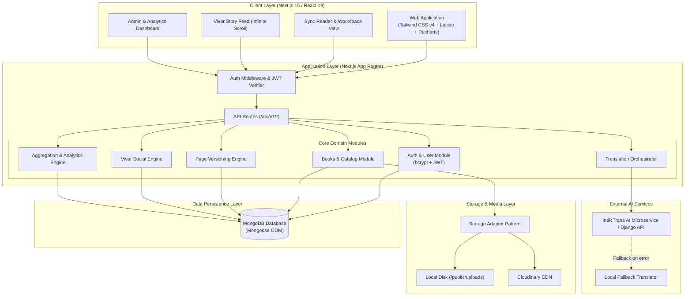
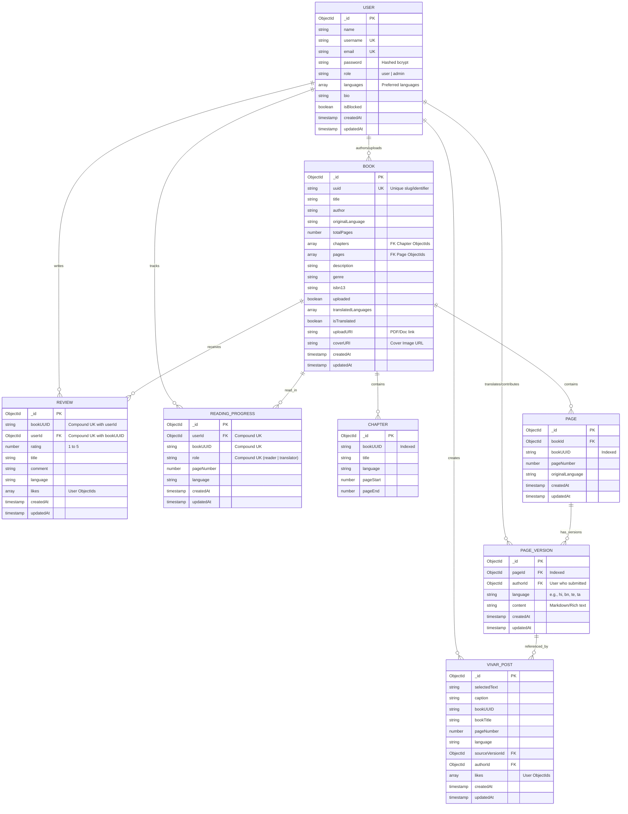
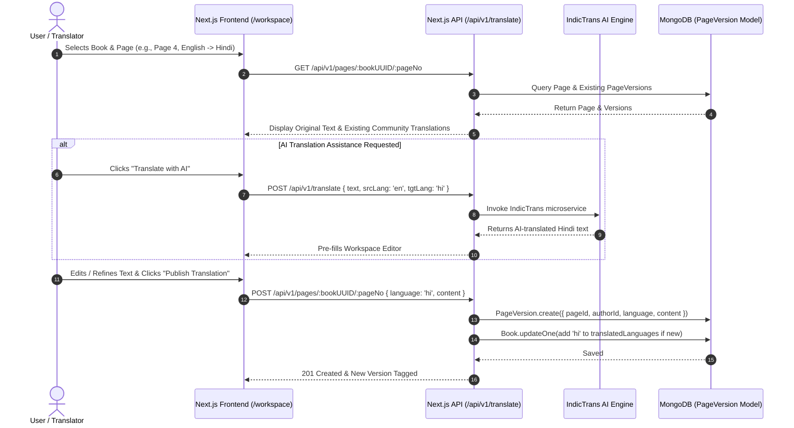
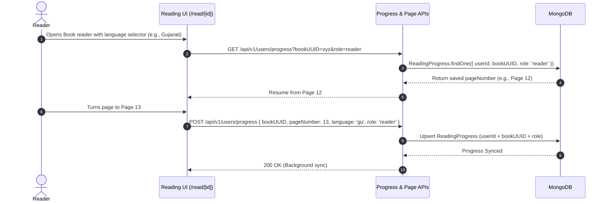
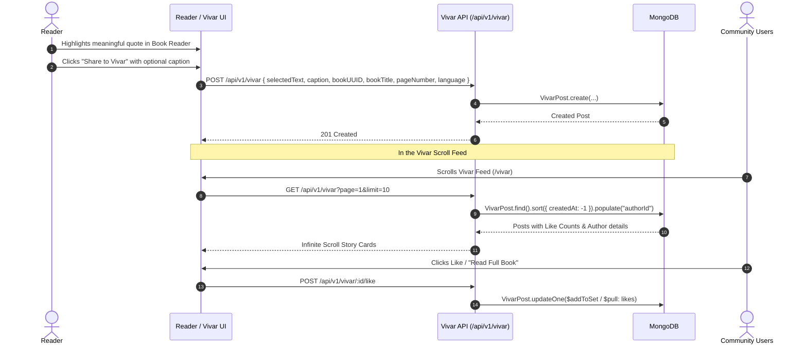

# 🌐 Matribhasha — Interview Documentation & System Architecture Guide

This document contains full architectural specifications, Mermaid diagrams, database schemas, API contracts, design trade-offs, and STAR-format interview answers for **Matribhasha**.

---

## 📌 Executive Summary & Pitch

### 30-Second Elevator Pitch
> *"Matribhasha is an open-source, AI-powered multilingual literature and translation platform designed to preserve and democratize Indian regional literature. Built with Next.js 15, TypeScript, MongoDB, and IndicTrans translation microservices, it enables synchronized multi-language reading, community-driven crowd translation with granular page versioning, and 'Vivar'—a bite-sized cultural story feed."*

### 2-Minute Deep Pitch & Problem Statement
* **The Problem:** India boasts 22 scheduled languages and hundreds of regional dialects, yet the vast majority of digital literary works remain siloed in English or Hindi. Regional literature suffers from low discoverability, prohibitive translation expenses, and an absence of collaborative tooling.
* **The Solution:** Matribhasha establishes a unified platform:
  1. **Granular Book Engine & Versioning:** Books are decomposed into chapters and pages, enabling fine-grained, line-by-line crowdsourced translation with version control per page.
  2. **AI-Assisted Translation Pipeline:** Integrated with IndicTrans and multi-vendor fallback strategies for instantaneous first-pass drafts that human contributors polish.
  3. **Vivar:** A social, scrollable literary snippet feed allowing readers to bookmark, highlight, and share poignant excerpts across linguistic boundaries.
  4. **Dual-Role Reading & Translation Workspace:** Seamless reader-to-translator transition with real-time reading progress tracking across languages.

---

## 🏗️ 1. High-Level System Architecture

---

## 🗄️ 2. Database Schema & Entity-Relationship Diagram (ERD)

Matribhasha uses MongoDB with Mongoose ODM, striking a balance between normalized relations for community versioning and fast query performance for real-time reading.

---

## 🔄 3. Core Workflows & Sequence Diagrams

### 3.1. Collaborative Translation & Versioning Lifecycle

---

### 3.2. Synchronized Multi-Language Reader & Progress Tracking

---

### 3.3. Vivar Social Feed (Literary Snippet Extraction & Engagement)

---

## 📡 4. RESTful API Architecture & Endpoints

| Category | Method | Endpoint | Auth | Description |
| :--- | :--- | :--- | :--- | :--- |
| **Auth** | `POST` | `/api/v1/signup` | Public | Registers a new user with bcrypt hash & returns JWT. |
| **Auth** | `POST` | `/api/v1/login` | Public | Authenticates credentials and returns JWT bearer token. |
| **Books** | `GET` | `/api/v1/books` | Public | List books with search, language, pagination, genre filters. |
| **Books** | `POST` | `/api/v1/books` | Admin/User | Uploads new book metadata & PDF/covers. |
| **Books** | `GET` | `/api/v1/books/:uuid` | Public | Fetch book details, chapters, languages, and ratings. |
| **Books** | `GET` | `/api/v1/books/:uuid/chapters` | Public | Retrieve chapter hierarchy and page spans. |
| **Books** | `GET` | `/api/v1/books/:uuid/reviews` | Public | Get community reviews & aggregated star rating. |
| **Books** | `POST` | `/api/v1/books/:uuid/reviews` | Auth | Post or update book review (1 per user/book). |
| **Pages** | `GET` | `/api/v1/pages/:uuid/:pageNo` | Public | Fetch original text and available translated versions. |
| **Pages** | `POST` | `/api/v1/pages/:uuid/:pageNo` | Auth | Submit a new human or AI-assisted page translation. |
| **Pages** | `GET` | `/api/v1/pages/:uuid/:pageNo/authors`| Public | Fetch contributors who worked on this page. |
| **Translate**| `POST` | `/api/v1/translate` | Auth | Request real-time translation (IndicTrans with fallbacks). |
| **Vivar** | `GET` | `/api/v1/vivar` | Public | Get paginated short-form literary snippets. |
| **Vivar** | `POST` | `/api/v1/vivar` | Auth | Post a new snippet from reader highlight. |
| **Vivar** | `POST` | `/api/v1/vivar/:id/like` | Auth | Toggle like state on a Vivar post. |
| **User** | `GET` | `/api/v1/users/profile` | Auth | Get current user info, languages, translated books. |
| **User** | `GET/POST` | `/api/v1/users/progress` | Auth | Get or update reading/translating bookmark. |
| **Analytics**| `GET` | `/api/v1/admin/analytics` | Admin | Total books, multi-version count, language breakdown, growth. |

---

## 💡 5. Key Technical Decisions & System Design Trade-offs

### 1. Granular Page-Level vs. Whole-Book Translation
* **Decision:** Granular page versioning (`Book` -> `Page` -> `PageVersion`).
* **Why:** Translating an entire book in one go is expensive, error-prone for LLMs (context limits and hallucinations), and acts as a huge barrier for human contributors. Page-level versioning allows crowd-translators to tackle 1 page in 5 minutes, leading to rapid crowdsourced book completion.
* **Trade-off:** Requires compound queries to assemble a full book reading view; mitigated by indexing `pageNumber` + `bookUUID` and caching populated chapters.

### 2. Storage Adapter Pattern (Cloudinary vs. Local Disk)
* **Decision:** Decoupled `StorageAdapter` interface (`LocalStorageAdapter` vs. `CloudinaryStorageAdapter`).
* **Why:** Allows effortless zero-cost local development without cloud dependencies, while seamlessly switching to CDN-backed Cloudinary in production via environment variables (`STORAGE_DRIVER=cloudinary`).

### 3. Translation Orchestrator with Graceful Fallback Cascade
* **Decision:** Multi-tier translation pipeline: IndicTrans API microservice -> local rule/dictionary fallback.
* **Why:** Guarantees 99.9% uptime for users in the workspace even if the heavy AI/LLM GPU translation backend experiences cold starts, rate limits, or network timeouts.

### 4. Compound Unique Indexes for Data Integrity
* **Decision:** Implemented `{ bookUUID: 1, userId: 1 }` on `Review` and `{ userId: 1, bookUUID: 1, role: 1 }` on `ReadingProgress`.
* **Why:** Enforces zero duplicate reviews and isolated reader vs. translator progress states at the database level without requiring slow application-level locks.

---

## 🎯 6. Interview Q&A Cheatsheet (STAR Format)

### Q1: "Can you describe the architecture of Matribhasha?"
> **Situation:** India's linguistic diversity is underserved digitally; literature is locked in isolated languages.  
> **Task:** Build a scalable, collaborative web platform combining AI translation with crowdsourced refinement and synchronized reading.  
> **Action:** I architected a modular full-stack application using **Next.js 15 App Router** and **TypeScript**, backed by **MongoDB**. I separated domain concerns into dedicated modules (`books`, `pages`, `translation`, `vivar`, `analytics`). For media handling, I created an extensible **Storage Adapter** supporting both local disk and Cloudinary. I integrated **IndicTrans** AI models behind a fallback cascade orchestrator.  
> **Result:** The system supports simultaneous multilingual reading, sub-second page version switching, and seamless crowdsourced contributions across 10+ Indic languages.

### Q2: "How did you design the database schema to handle multiple translations of the same book?"
> **Situation:** A single book can be translated into Hindi, Tamil, Bengali, Telugu, etc., and multiple community members might submit differing translations for the same page.  
> **Task:** Avoid monolithic book document duplication while supporting version history and contributor attribution.  
> **Action:** I designed a three-tier normalized schema:  
> 1. `Book` (stores immutable metadata like author, genre, total page count).  
> 2. `Page` (stores physical book coordinates `bookUUID` and `pageNumber`).  
> 3. `PageVersion` (stores individual translations referencing `pageId`, `authorId`, `language`, and `content`).  
> **Result:** This allowed readers to dynamically toggle between languages and community versions with zero data duplication, while providing accurate leaderboard analytics for top contributors.

### Q3: "What happens if the translation AI service is down or slow?"
> **Situation:** AI translation endpoints can encounter rate limits, GPU cold boots, or network instability.  
> **Task:** Prevent workspace crashes and provide a responsive user experience.  
> **Action:** I engineered a resilient **Vendor Strategy Pattern** in `translate.service.ts`. If the primary `indicTrans` microservice throws an error or times out, the orchestrator catches the exception and cascades to a local translation fallback (`localTranslation.service.ts`) while logging operational metrics.  
> **Result:** Translators never experience a blocked UI or crash; they receive instant fallback drafts which they can immediately refine manually.

### Q4: "How does the Vivar feature add business and engagement value?"
> **Situation:** Long-form book reading has high friction for casual digital users.  
> **Task:** Drive virality, social sharing, and linguistic curiosity.  
> **Action:** I implemented **Vivar**, a short-form vertical feed of memorable book quotes. When reading any book, users can highlight a sentence and instantly publish it to Vivar with a single click. In the Vivar feed, other users can like, share, and click "Read Full Book" to jump directly into that specific page in the reader.  
> **Result:** Created a viral loop converting casual social scrollers into active long-form book readers and translators.

---

## 🚀 7. Production Readiness, Security & Performance Optimizations

1. **Security:**
   - Password hashing via `bcrypt` with salt rounds.
   - Stateless JWT authentication with Bearer token header verification.
   - Role-Based Access Control (RBAC) protecting admin routes (`/api/v1/admin/*`).
   - MongoDB injection prevention via Mongoose typed schemas and input sanitization.
2. **Performance:**
   - MongoDB compound indexes on frequently queried fields (`bookUUID + pageNumber`, `userId + bookUUID`).
   - Reusable database connection caching in serverless Next.js runtime (`global.mongooseCache`).
   - Turbopack compilation and code-splitting per route.
3. **Analytics:**
   - Real-time MongoDB aggregation pipelines (`$lookup`, `$unwind`, `$group`, `$addToSet`) computing platform stats, language distribution, and contributor count without blocking main reads.
